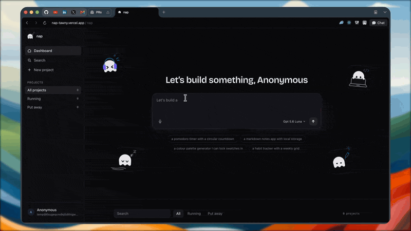

# nap

**Give a coding agent a task. Step away. Come back to a verified commit, with evidence behind it.**

nap is an open-source cloud coding agent. You describe a change in chat, for a new app or for a
GitHub repository you connect. An agent works on it in its own isolated cloud machine, with files, a
terminal and a desktop whose browser it can see and click. nap runs the project's own checks before
it calls the work verified, can test the running app and record what the agent saw, and opens a
pull request for a connected repository.

Use nap as a hosted app, a local runtime, or a reference implementation for long-running
coding-agent systems.

A model saying "done" is a claim. A passing checkpoint is evidence.

[](https://github.com/mangit955/nap/actions/workflows/ci.yml)

[Live demo](https://nap-tawny.vercel.app) · [Docs](https://nap-tawny.vercel.app/docs) ·
[Architecture](https://nap-tawny.vercel.app/docs#architecture)



The GIF is a 22-second cut from a real two-minute session. It shows the prompt, sandbox tool calls,
project checks, verification, and the resulting app. The [full session is on the docs page](https://nap-tawny.vercel.app/docs).

Without an account, you can [watch a recorded session](https://nap-tawny.vercel.app/replay/reading-list)
play back in nap's own workspace, ending in the app it built; nothing runs while you watch, so it
costs nothing.

**On a real repository.** The live deployment took one task for a public GitHub repository, a
small tip calculator, and returned [a reviewed draft pull request](https://github.com/mangit955/tab-split/pull/1)
that adds splitting the bill. Before opening it, nap ran the project's checks and had a second
model review the change. Then it tested the running app in its own browser and recorded the test,
for about a cent of model spend. The first attempt failed on a bug that
[a fix](https://github.com/mangit955/nap/pull/289) removed, and the first recording was lost to
[another bug](https://github.com/mangit955/nap/issues/290). The
[write-up](docs/napbench-production-loop.md) covers the run, its cost, and what it did not prove.

## What nap does

- **Builds in an isolated workspace.** The agent reads and edits files in an E2B sandbox. A Vite
  server exposes the project through a live preview while the turn runs.
- **Keeps work after the browser goes away.** The API admits a turn to a durable Postgres queue. A
  worker executes it, so closing a tab or deploying the API does not cancel the work.
- **Streams from a durable event log.** Events are appended before they are published. A reconnect
  asks for everything after its last sequence number, so it can catch up without duplicates or gaps.
- **Separates commits from checkpoints.** Every file-changing turn creates a commit. Only a commit
  that passes the discovered checks becomes a checkpoint, which is nap's last known-good state.
- **Repairs bounded failures.** A failed check opens another turn with the failure in its context.
  The repair budget has a hard limit.
- **Works on your repositories.** Connect a GitHub repository and each job works on its own branch.
  Before a job whose checks pass becomes a draft pull request, a second model reviews it by running
  commands, and a problem it proves sends the agent back. What the review of the published commit
  noted without proving is in the description of the draft it opens. Review feedback you approve
  on the pull request starts the next job.
- **Tests the app like a user would.** On a model that can read images, the agent gets a desktop
  with Chrome on the project's dev server. "Test the app" states each expectation before acting,
  records a video, and offers a fix when something fails. It never starts the fix on its own.
- **Puts idle projects away.** nap stores the Git repository, destroys the idle sandbox, and restores
  the project when you return.

## How a prompt becomes a verified project

```text
prompt
  ↓
durable job → worker → agent in sandbox → commit
                                      ↓
                              project checks
                                ↙       ↘
                           pass          fail
                            ↓              ↓
                       checkpoint    bounded repair turn
```

The job and its transcript come from the same append-only event log. That gives nap one answer to
what happened, what was verified, and where to continue. The full event model, job lifecycle, and
verification rules are in the [technical docs](https://nap-tawny.vercel.app/docs#verification).

## Evidence, with scope

These are historical measurements, not a promise about every deployment. The load test used fake
model and sandbox providers, so it measured nap's queue, event log, workers, and WebSocket path. The
real-model measurements tested the verification path and did not establish a model-score improvement.

| Result | Measurement |
|---|---:|
| Concurrent turns in the latest cluster run | **100** |
| Turns completed in that run | **2,422** |
| Job, turn, and verification completion | **100%** |
| Sequence gaps, duplicate events, WebSocket failures | **0** |
| Event delivery at 100 concurrent turns | **20 ms p95** |
| Fast local suite at this revision | **7,266 passing tests in 480 files** |

The latest cluster run included 231 mid-turn reconnects. It ran on 24 August 2026 after an earlier
run on 23 August. Read the [cluster report](docs/scaling-cluster.md) and the [single-process baseline](docs/scaling-baseline.md)
for the test profile, caveats, and comparison.

The verification measurements covered 12 real runs and cost $0.15 in total. They found and fixed a
real verifier blind spot, but the sample was too small to support a claim about score improvement.
See the [first measurement](docs/napbench-verification-measurement.md) and the
[re-measurement](docs/napbench-luna-remeasurement.md).

On 25 locked Terminal-Bench 2.1 tasks with `gpt-6-luna`, of the times nap first said it was done, 15
in 24 ended false without the reviewer and 5 in 29 with it, mostly because the reviewer sent the
false ones back. When nap said "done" the hidden tests agreed about three times in four, up from
three in eight. The pass rate did not measurably move (24% across two baselines, 29% across three
runs with the reviewer, inside the noise). See the
[baseline](docs/napbench-terminal-bench-baseline.md) and the
[reviewer measurement](docs/napbench-terminal-bench-reviewer.md).

Run `bun run test:fast` to reproduce the local-suite result. The cluster numbers use fake model and
sandbox providers. They describe the deployment path, not production model or sandbox capacity.

## Try it without credentials

The runtime has fakes for external services, so you can exercise the core loop locally without
Docker, API keys, network access, or spend.

```bash
bun install
bun run test:fast
bun run harness "build a todo list"
bun run ws:smoke
```

The harness prints the event stream for one complete turn. The smoke test drives the WebSocket path
over a real socket. `test:fast` runs the unit, type, and web suites without Postgres.

## Run the full app locally

You need [Bun](https://bun.sh), Docker, an [E2B](https://e2b.dev) key, a model-provider key, and a
Cloudflare R2 bucket for snapshot storage.

```bash
bun install
docker compose -f infra/docker-compose.yml up -d
cp apps/api/.env.example apps/api/.env
```

Fill in the required values in `apps/api/.env`. For a local worker setup, also set:

```dotenv
NAP_EVENT_BUS=postgres
```

The example file documents each variable. The API validates its configuration at startup, including
the database, model provider, authentication, key encryption, and snapshot storage settings.
Production also rejects configurations that would make sign-in depend on third-party cookies.
See the [deployment requirements](docs/DEPLOY.md#one-site-for-both-halves).

Start the processes in separate terminals:

```bash
bun run db:migrate
bun run dev          # web: http://localhost:3000, API: http://localhost:3001
bun run dev:worker   # claims queued turns and runs them
# bun run dev:reaper # optional locally; puts idle projects away
```

Open [http://localhost:3000](http://localhost:3000), describe the app you want, and watch the agent
work. The worker is required for a turn to execute. The reaper is optional in development.

Every real turn uses a model call and a sandbox. Use the fake harness for a free local run. Use
`--real` only when you intend to spend money:

```bash
bun run harness --real "build a todo list"
```

## Run the checks

```bash
bun run test:fast       # unit, type, and web suites; no Docker
bun run test            # all TypeScript suites; the db suite needs Docker
bun run typecheck       # workspace and root TypeScript checks
bun run lint            # Biome
bun run build           # production builds
```

The Python benchmark harness has its own gates:

```bash
bun run lint:py
bun run test:py
```

Use `bun run test`, not `bun test`. Bun treats `test` as its own built-in command and skips the
repository's Vitest project configuration.

## Repository map

| Path | Role |
|---|---|
| [`apps/web`](apps/web) | Next.js interface: chat, transcript, and live preview |
| [`apps/api`](apps/api) | Hono API, WebSocket streaming, authentication, admission, worker, and reaper processes |
| [`apps/verify-nap`](apps/verify-nap) | Developer tool that drives a real Chrome against a local nap to prove a UI change |
| [`packages/runtime`](packages/runtime) | Turn lifecycle, jobs, commits, verification, checkpoints, and continuation |
| [`packages/agent`](packages/agent) | Model loop, its sandbox-backed tools, and the helpers it can hand a search to |
| [`packages/context`](packages/context) | Prompt assembly, token budgets, and truncation |
| [`packages/sandbox`](packages/sandbox) | Sandbox, filesystem, command, and preview ports plus the E2B adapter |
| [`packages/db`](packages/db) and [`packages/storage`](packages/storage) | Postgres event data and Git bundle snapshots in R2 |
| [`packages/verify`](packages/verify) | Project checks |
| [`harbor`](harbor) | Python adapter that runs nap's agent on Terminal-Bench under Harbor |
| [`infra/k8s`](infra/k8s) | Kubernetes manifests and proof/load-test environments |

## Architecture in one picture

```text
Browser
   │ HTTP + WebSocket
   ▼
API process ──► Postgres queue ──► Worker process ──► Runtime ──► E2B sandbox
   ▲                  │                  │               │
   └──── event log ◄──┴──────────────────┴───────────────┘

Reaper process: snapshots idle projects, reconciles capacity, and closes orphaned turns.
```

The API serves and admits work. The worker executes turns. The reaper handles cleanup. They share
one composition but have separate responsibilities, which lets a deployment scale and drain them
independently. The [architecture docs](https://nap-tawny.vercel.app/docs#architecture) explain the
package boundaries and invariants. The [ADRs](docs/adr) explain decisions that are expensive to
reverse.

## Current scope

The durable job loop, worker queue, verification and repair, checkpoints, project continuation,
and the multi-process deployment are implemented. nap is still deliberately focused:

- No multi-agent orchestration.
- No built-in billing.
- No Monaco editor or terminal in the web app.
- User sandboxes still run through E2B rather than Kubernetes pods.
- Long-term memory is an interface with a no-op implementation.

Those boundaries have extension points in the code. See the [full docs](https://nap-tawny.vercel.app/docs),
[`docs/DEPLOY.md`](docs/DEPLOY.md), and [`harbor/README.md`](harbor/README.md) for operational and
benchmark details.

## Read next

- [How nap works](https://nap-tawny.vercel.app/docs) for the event model, jobs, verification, sandboxes, and scale.
- [`harbor/README.md`](harbor/README.md) for running and scoring nap's agent on Terminal-Bench.
- [`docs/scaling-design.md`](docs/scaling-design.md) for queue semantics, leases, and load-test invariants.
- [`docs/DEPLOY.md`](docs/DEPLOY.md) for deployment topology and environment variables.
- [`docs/gotchas/`](docs/gotchas/README.md) for constraints that have caused real failures, one file per area.
- [`AGENTS.md`](AGENTS.md) for repository commands and contribution conventions.
- [`SECURITY.md`](SECURITY.md) to report a vulnerability.

## License

[MIT](LICENSE) © 2026 Manas Raghuwanshi
