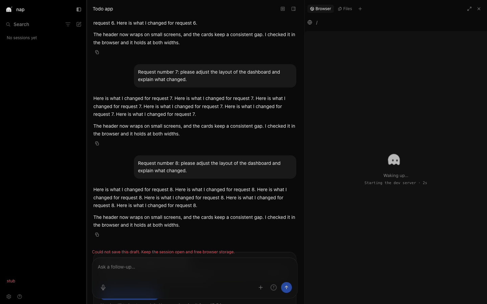
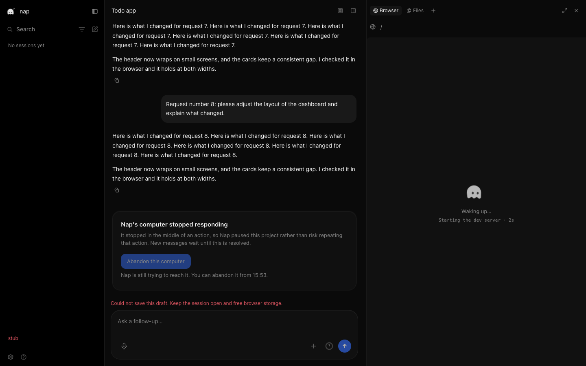

# Recovery notice evidence

These are preserved verification artifacts, not a new run. The tested repair tree is `9d20cea4052ac0ab05d8ef0420a83e93113784c8`, originally snapshot `02097954f8da86a3778d5e0c0d0f2b76d7ddf8c9` with parent `e2fab6562b98bbf03add11cadad7d9bbec6e30f2`. Reviewed checkpoint `a9f27d18fa76cd097564d2e3dd2d51c3718c9523` has that exact tree. Base is `13f7fa7f478982ed9316f2348f2ee5f61214bd00`. The evidence-only commit that publishes this directory is separate from the tested source checkpoint.

## Scenario and method

The independent checker served the real production Next.js 16.3.0 build with `next start` on port 3194, using playwright-core 1.57 and headless system Google Chrome on macOS. Every API request to localhost:3001 and the WebSocket were stubbed in the browser. The WebSocket supplied 32 events across eight turns. Recovery returned `stuck: true` and an abandon time two minutes ahead. The checker held that reply until the transcript settled at its bottom, then released it. This tests a late recovery notice after chat stops moving.

All four original `notice-*.png` captures are copied byte for byte at 1440×900 and 390×844, under dark and light emulation. The workspace itself forces dark color scheme, so the light captures do not demonstrate a separate light theme. The browser recorded no page errors. This proves layout and scroll behavior with supplied responses, not real recovery API behavior.

## Before and after

The before captures are actual negative-control screenshots. Starting from the tested repair tree, the checker removed `:${noticeShown}` from the stick-to-bottom signal, rebuilt, and ran the same browser scenario. They are not captures of main, which has no computer feature, or a separately checked-out e2fab65 build.

- At 1440×900, the negative control placed the notice at y=746.25–940.75, behind the composer starting at y=762. The repair placed it at y=519.25–713.75.
- At 390×844, the negative control placed the notice at y=673.5–907, behind the composer starting at y=706. The repair placed it at y=408.5–642.
- All four negative cases recorded `inViewport: false`, `overlapsComposer: true`, and `atBottom: false`. All four repaired cases recorded the opposite values. The mutant browser exited 1. Its wrapper completed restoration and rebuilding successfully.

Desktop before:

Desktop after:

Narrow [before](before-narrow-390x844-dark.png) and [after](notice-narrow-390x844-dark.png) retain the same scenario. `browser-negative.json.txt` and `browser-candidate.json.txt` preserve the exact measured coordinates and synthetic request log. `browser-negative.log` preserves the failed oracle and successful restoration.

## Regression and gate records

`before-e2fab65-notice-excerpt.txt` preserves the original notice component's false claim of loss for a `clear` reply, using the candidate tests. Its raw log does not retain the exact invocation. `mutation-clear-copy.log` independently records the exact replacement and argv that reproduce that failure on the repaired tree. `mutation-compare-and-clear.log` records the PostgreSQL regression failing when release stops comparing the sandbox ID. These are deliberate regressions, not failures on the restored tree.

The final default suite passed 6,044 tests in 446 files with no type errors. The first run had two five-second DB timeouts under concurrent host load. Those two files passed 18 tests in isolation, then the full suite passed. The original failing summary is retained alongside the passing summary. Typecheck passed, including the root pass, and a forced workspace run passed 14/14 with zero Turbo cache hits. Lint exited 0 with two warnings and two infos. Forced build passed 1/1 with zero Turbo cache hits and 15/15 pages. Next's internal cache was warm and Next skipped type validation, which the separate typecheck covers.

`native-l2-success-excerpt.txt` is an unchanged partial JSON excerpt from an earlier Linux physical-input proof at snapshot `53ffa8f569c843e251944635a51d53cdb8d58a56`, tree `19d19ae4b0b58d6448ea53f4d66597449bc2d667`, bundle `89b1e4898d4c871f56ab4e202372103b1cbb95dc9b14419dd1fde78c8c6b485f`. It is historical local evidence, not a rerun on a9f27d1 or an E2B result.

## Provenance and privacy

[PROVENANCE.tsv](PROVENANCE.tsv) records each original absolute path, retained byte or line range, recorded command, revision, mutation, and SHA-256. [SHA256SUMS](SHA256SUMS) covers every published file except itself. Log excerpts retain their original bytes and whitespace. No output was reconstructed or rerun to write this directory.

The screenshots contain synthetic transcript and account data. Visible fixture artifacts are the sidebar's `stub` error, the unchanged draft-persistence error, and a preview stuck at “Waking up…” because the fixture sends no `preview.ready`. They are not private user-session captures or evidence of those production failures. No cookies, credentials, environment dumps, private accessibility trees, or new Devin captures are included.

These Nap captures do not establish equivalence to missing Devin recording-viewer or take-control states. Matching references remain GH-B-04. No paid cloud acceptance occurred here. GH-R-01, production template publication, proxy behavior, real cloud cancellation, and real-model trials remain open under FREE ONLY. Production boot composes the desktop adapter: deployment must wait for a matching validated template and the cloud acceptance gate.
