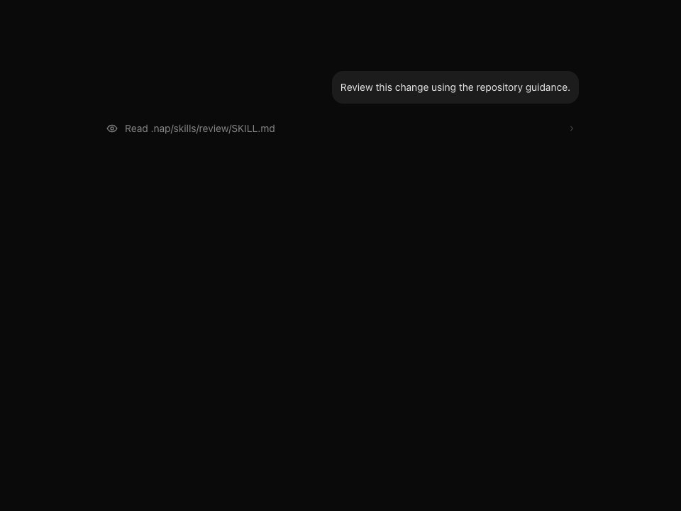
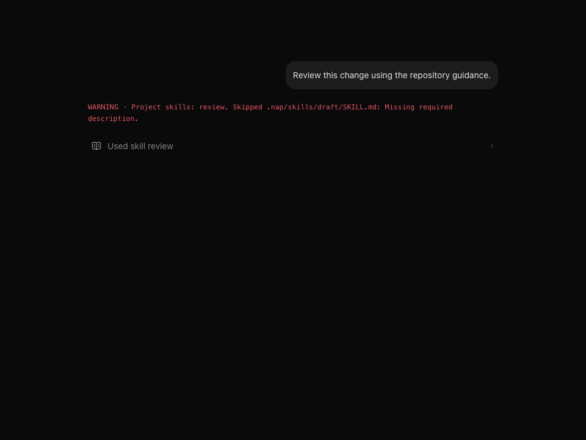
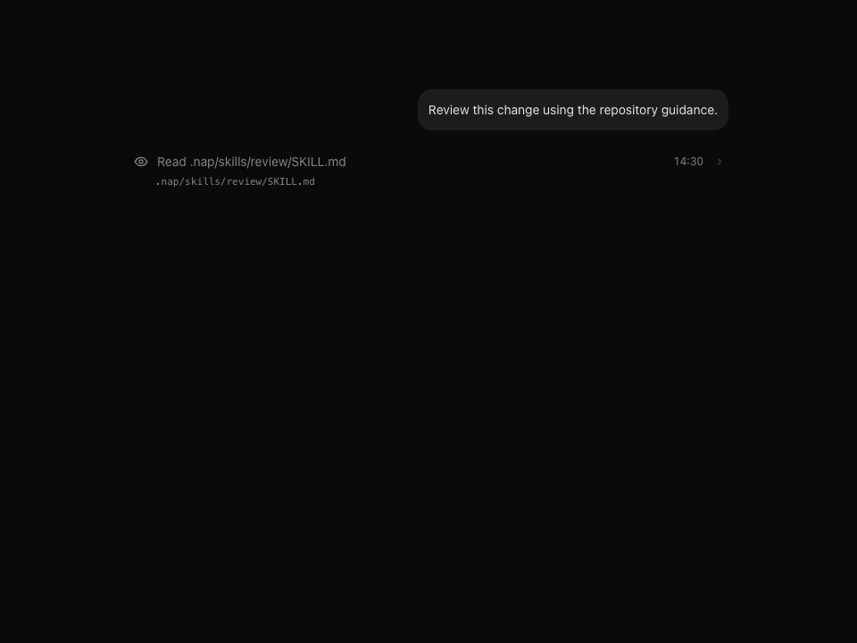
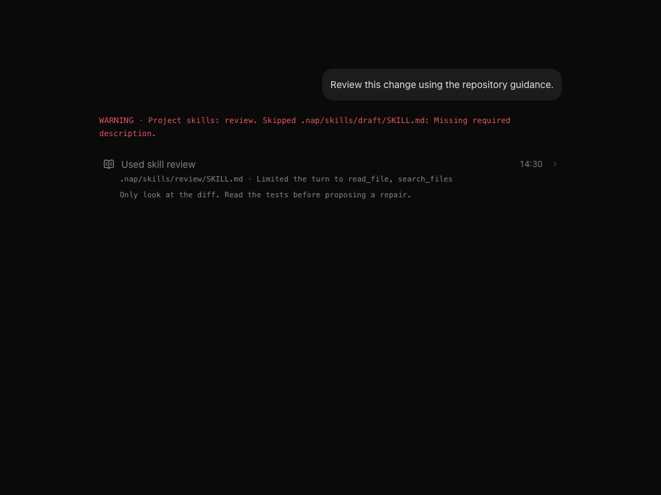

# Repository skills evidence

Captured on macOS 27.0.1 arm64 using local Chrome, Playwright and the actual `ChatTranscript`, event fold and compiled theme CSS. These are deterministic event fixtures, without a model, E2B or server.

Before screenshots use base `86824380df437058f435f27547153532502579e1`, reading a `SKILL.md` with `read_file`. That revision had no skill tool. After screenshots use feature `0aa64d5a3427de8452d433d0374db5e3318e22ae`, with discovery and skill-load events. The chat source and theme are unchanged by the repair snapshot `942ec98a8d520728c804067a8b9f4cbaca34408c`, tree `ecac3f2099ed7fa54ab47dc1e31d6ba12bfa74a3`, committed as `729d2ab`. Collapsed and expanded screenshots show the existing disclosure behavior; this feature adds no new disclosure interaction.

| State | Before | After |
| --- | --- | --- |
| Collapsed |  |  |
| Expanded |  |  |

`regressions-before.txt` records three new tests failing against original production code. `reason-limit-before.txt` records the additional diagnostic-length failure. `regressions-after.txt` records all 54 focused tests passing after repairs. These commands used `bun x vitest run --project unit` with the shared skills, agent skill tool and context listing test paths, or only shared skills for the reason-limit red check.

`verification.md` records exact snapshot coverage and the full free gates. `harness.txt` demonstrates discovery, load and persisted event flow with the scripted model and in-memory sandbox. Its fixed toggle demonstration does not depend on the input prompt.

Real model selection/adherence and E2B latency, missing-folder mapping and symlink behavior remain untested. The sandbox port reads whole files before enforcing the skill size cap, and its discovery deadline cannot cancel requests already sent.
