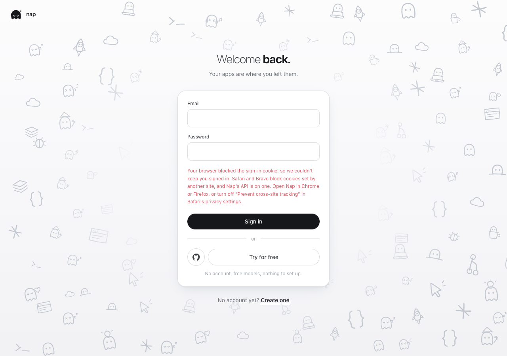
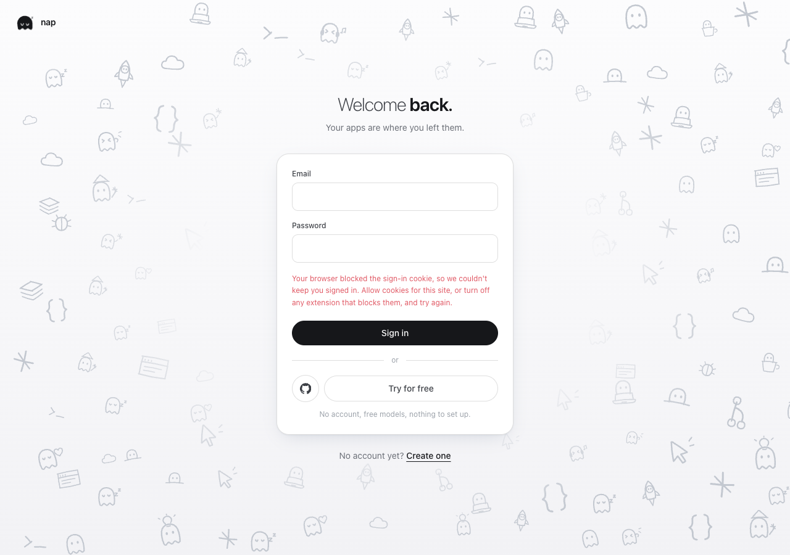

# Sign-in cookie error evidence

Captured in Chrome 156.0.8078.80 at 1280 × 900. These are the actual `LiveSignIn` and `SignInForm` components, with the app’s compiled styles. The fixture clicks **Try for free**, returns successful authentication, then returns no session to simulate a cookie the browser did not retain. Network and Next navigation boundaries are explicit fixture adapters. This demonstrates the error state, not real browser cookie policy or an OAuth provider round trip.

- Before component: `420f9d2839f7cfcded3a4b75bdaa285f002c0371`.
- After component: `b6368f03ae20833f8193a6a78d134d51fa00be0e`. Its source is unchanged by the subsequent main synchronization.
- Scenario metadata: `before.json` and `after.json`.

The supervised capture used `Bun.build` for the real component and explicit auth/router adapters, then a disposable headless Chrome. Both states had no page errors. Fixture captures do not establish Safari acceptance. The run ledger retains the generator and original log.
